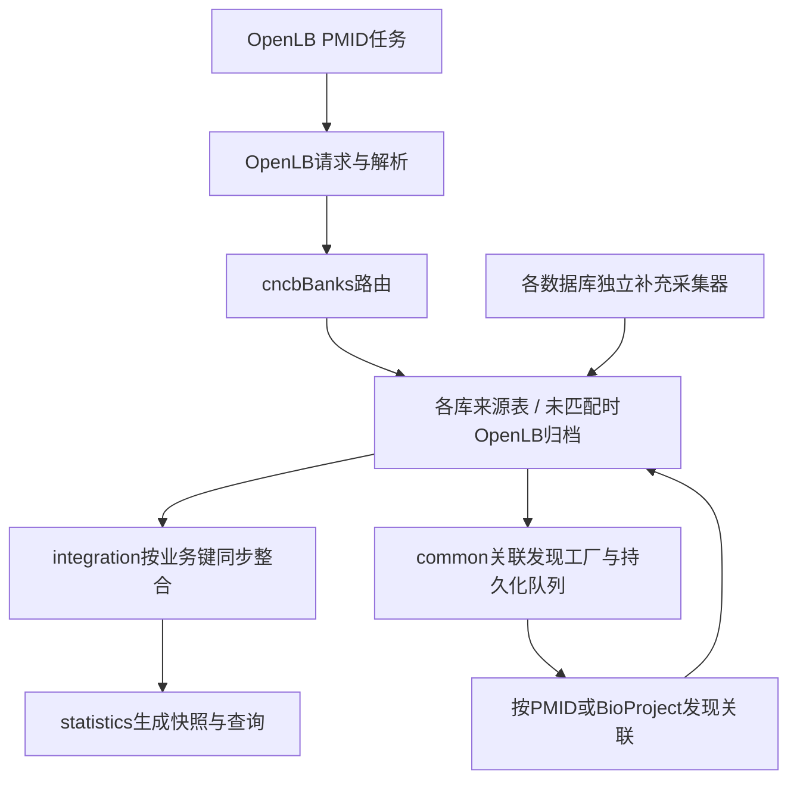

# 功能模块与科研模块包结构

## 目录

```text
com.example.bioplatform
├── catalog                         资源与工具推荐；业务逻辑保持不变
├── common / config                 应用公共响应、异常、Web 配置
└── research                        科研模块
    ├── collection                  采集
    │   ├── openlb                  独立 PMID 任务、盘点、路由与分流
    │   ├── genbase                 GenBase 补充采集、补全与来源适配
    │   ├── gsa                     GSA 补充采集、列表解析与来源适配
    │   ├── bioproject              BioProject 补充采集、详情解析与来源适配
    │   ├── biocode                 BioCode 关联资源解析
    │   ├── databasecommons         Database Commons 关联资源解析
    │   ├── ascancer / gwh          各自关联资源解析
    │   └── common                  公共队列、关联发现工厂、写入策略、HTTP传输
    ├── integration                 跨来源整合、业务键、资源记录、来源注册
    ├── statistics                  快照构建、统计查询、排名与穿透
    └── common                      作者机构、基金、主题、链接及字段处理
```

各分包内部按 `controller / service / service.impl / mapper / dto / vo` 分层；仅存在实际使用的层级。关联发现策略和工厂位于 `collection.common.service.relation`，不归属具体数据库。作者与机构处理入口为 `common.PublicationMetadataProcessor`；原始基金处理为 `common.GrantPayloads`，统计基金解析为 `common.FundAgencyParser`。共用 HTTP 传输为 `collection.common.service.impl.CollectionHttpTransport`，OpenLB 自有采集线程与限流器保持独立。

MyBatis Java 接口只保留方法、参数和映射元数据，不写 SQL。SQL 位于 `portal-backend/src/main/resources/mapper/catalog` 和 `mapper/research`，本次将 62 条注解 SQL 原样迁入 XML。注册扫描限定为标注 `@Mapper` 的接口，避免把服务接口误注册为 Mapper。

## 数据流程



OpenLB开始采集不会启动GenBase、GSA或BioProject的独立采集任务。原有自动整合同步保留；统计依然只读取本地数据。是否启动关联队列依照原有接口与任务配置，不因拆包自动触发。

GenBase已移除最近加入的无文献资源观察/退休处理；不因此创建额外资源记录。其他来源的既有功能不随之删除。

本次修复OpenLB结束任务时恢复SQL异常会跳过运行标记清除的问题。现在即使恢复失败也会释放运行标记、记录结束时间并报告异常，避免永久阻止再次启动。未删除失败状态或把失败任务标为成功。

## 扩展与验证

新增数据库的专属实现放入 `collection.<数据库名>`，实现既有来源与关联解析接口，由注册/策略工厂装配。通用规则放入 `common`；已有数据库不需要为新增来源更改自己的处理逻辑。数据库路由配置和所需表仍需要按部署流程准备，本次不自动新建或修改真实数据库。

接口URL、前端路由、数据表名保持不变。前端保留 `modules/catalog`、`modules/research` 及 `shared`，无需因后端拆包修改接口请求。测试全部使用H2或模拟依赖，不执行真实爬取/历史回填。

```powershell
python scripts/check-module-boundaries.py
mvn -f portal-backend/pom.xml clean test
# portal-frontend目录
npm test
node --test src/modules/research/utils/links.test.js
npm run build
```

移动包后应执行干净构建，避免target残留旧包。变更前源码备份在项目 `.tmp/research-packages-backup.zip`；本次无更早Git历史可用，因此没有宣称恢复了无法核验的历史版本。

## 本次验证结果（2026-11-25）

- 后端 `clean test` 成功，64 项测试通过，包括任务一集成回归和3项OpenLB链路测试。
- 前端7项测试通过，生产构建通过。
- 9个科研模块控制器的路由注解与拆分前一致。
- 全部Mapper Java接口无增删改查SQL注解，62条注解SQL已迁到XML。
- 模块边界检查通过，API测试JSON生成器已支持按新包路径查找控制器。
- 未调用真实上游、未修改真实数据库；因此生产环境网络、路由表配置及上游可用性不属于上述测试结论。

## 无文献资源存储简化（2026-11-25）

无文献资源直接保存在 `research_stat_publication`，以 `record_kind=RESOURCE` 和 `数据库代码:RESOURCE:原库编号` 唯一键识别。`ResearchResourceMapper` 是整合表资源行的访问接口，不对应额外资源表。资源API、混合快照、分库穿透和公共关联队列的接口不变。原始JSON与资源关联状态也在整合表保存。

生成快照不再从额外资源表复制数据；资源新增/更新时直接UPSERT整合表，有原生文献时停用对应资源行。文献全量重建只重建文献行，保留资源行和历史资源穿透键。

数据库升级执行 `database/task2-resource-direct-storage-20261125.sql`。确认旧资源表无数据、切换新版后端后，执行 `database/task2-drop-empty-resource-table-20261125.sql`；该脚本只删除空表，非空时保留并提示先迁移，不自动回填历史数据。当前初始化schema不再创建额外资源表。
