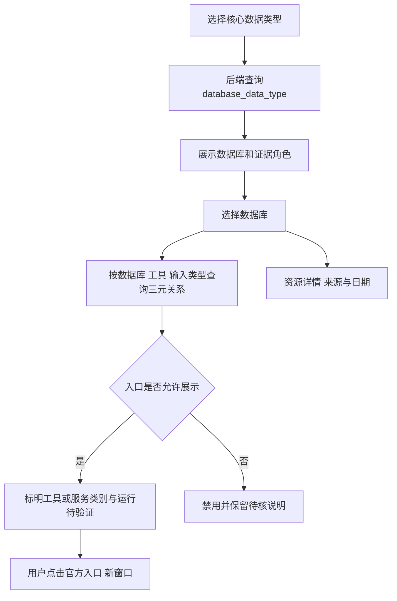
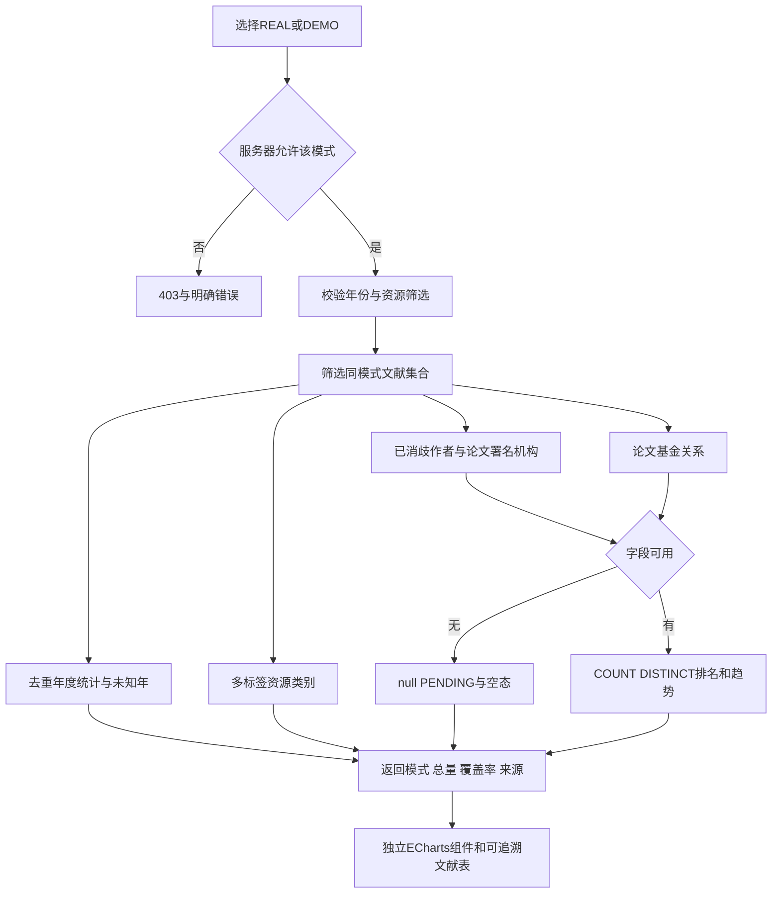
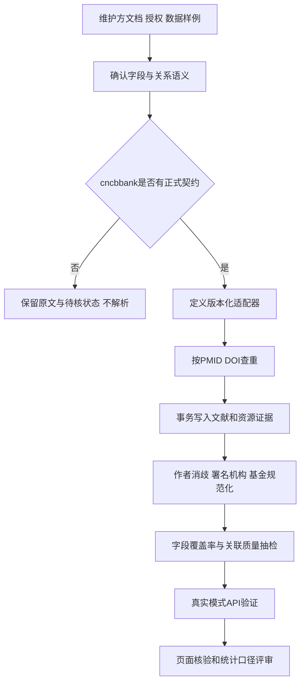

# 业务与数据接入流程

## 推荐流程

不自动上传数据、不URL拼接预填、不把元数据标签等同实际序列。数据库没有匹配工具时明确空态，不自动把全平台工具挂上。

## 科研统计流程

机构统计仅看论文署名，不能用提交机构代替。身份必须同模式；真实未知不借用合成身份。当前图表反映入库集合，不称作中心完整成果或综合科研能力。

## 真实数据接入与后续建模

当前实现了本地目录与统计流程，不包含E节点的外部采集适配器。OpenLB没有已验证批量API和cncbbank格式，不能据字段名设计假调用。18项官方接口只作为接入清单，后续需逐个确认认证、限流、错误码、分页和许可。

## 新增表的实施顺序

业务字段证据/需求→迁移DDL及外键索引→实体Mapper→服务层模式隔离与缺失语义→VO与OpenAPI→前端复用组件→SQL/HTTP/浏览器验收→文档与迁移记录。不要只改schema却不改查询/DTO，也不要让Vue直接依赖源平台原始JSON。
