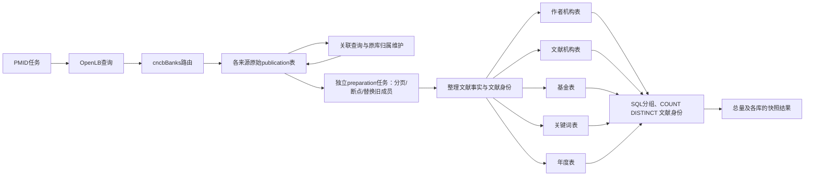

# 统计整理改造：代码与数据库核对

本次按用户直接实施指令先做只读核对，再实施三段流程。截图中的逻辑表名不直接当作现有结构。

## 实际情况

- 干净编译通过，未发现回滚后Java编译错误。清理target避免旧authorcentric字节码留在运行类路径。
- OpenLB入口是OpenLbCollectionServiceImpl，任务表openlb_pmid_task。PMID查询后，persistBatch在一个事务里分流、同步旧整合表、标记任务成功。
- 分流使用OpenLbRoutingService及openlb_bank_route，按cncbBanks.db映射到source_code，再使用经过严格校验的<source_code小写>_publication表。GENBASE有专用写法。未知或空银行写openlb_publication兜底，OpenLB不作为独立统计来源。
- 数据库实际启用12个来源：ASCANCERATLAS、BIOCODE、BIOPROJECT、BIOSAMPLE、DATABASECOMMONS、EWAS、GEN、GENBASE、GSA、GVM、GWH、OMIX。不能固定成截图中的六个。
- GenBase/GSA/BioProject已有独立来源适配器，其余使用注册路由适配器。无文献资源由ResourceAwareResearchPublicationSource补充。
- 关联文献保存在当前来源自己的publication表，is_primary区分本库，is_related记录关联发现，两个标记可同时为1。research_publication_relation按库保存双向规范化关系，不把跨库归属当关联边。
- 新发现关联文献当前写入is_primary=0；已经是主文献的记录不会降级。但是明确cncbBanks证据指向当前库时，仍需补上提升本库标记的步骤。
- 实际gsa_publication.pmid为NOT NULL，与原生支持文章允许无PMID的代码不一致，需单独作为采集兼容修复，而不是为统计重构原表。
- 旧快照在构建阶段拆JSON并写candidate/穿透关系，数据量随快照重复增长，不适合新的整理后聚合方式。
- 数据库残留research_author_*五张表，但源码已回滚。新版不读取、不清空它们，不恢复作者展开引擎或自动同步队列。

## 流程

## 设计边界

整理包research.preparation独立于采集。所有关联文献均整理，快照才根据includeRelated和includeResources过滤。各维度共用来源编码和文献身份，按“来源文献版本＋成员”唯一，不按作者×基金×机构交叉展开。

同PMID跨来源复用全局文献身份；无PMID使用规范DOI，最后回退到本来源稳定唯一键。年份冲突按范围内最早已知年份统计，避免同文献重复落入多个年份。相同DOI对应多个冲突PMID不能盲目合并。

作者机构按一位作者的一个机构拆分，保留原顺序和空机构作者。姓名机构只表示统计署名组合，不宣称识别了跨文献真实人物实体。文献机构独立去重，同文献同机构只计一次。

整理事实按有效版本保存。每批事务包含旧成员版本失效、新成员写入和游标提交。失败批次回滚，已完成批次不重来。未完成版本不用于新快照。重建创建新整理版本，不删除历史快照依赖的数据。

快照只读取整理表，一次只JOIN一个维度与整理文献事实，避免笛卡尔积。总统计COUNT DISTINCT document_key，分库再加source_code；不创建TOTAL文献副本，不重复保存快照全量文献关系。保留现有快照元数据表和API形状，新增冻结整理版本/分类配置表，复用现有小规模维度结果表，旧格式快照保留但不冒充新版整理快照。

## 修改范围

- 新增preparation控制器、任务服务、纯解析器、身份解析器、Mapper及XML。
- 新增statistics.prepared统计服务及Mapper/XML，替换默认快照实现，保留旧实现供历史参考，不再作为默认Bean。
- 前端新增整理任务面板，沿用原图表、分页和关联查询。
- 新增带字段描述的整理层迁移SQL；原始文献表不为统计增列。通过research_prepared_snapshot保存快照整理版本、来源名称及主题映射；原快照表不增列。
- 只修复已确认的采集标记/表约束问题。不得运行上游采集或业务历史回填。
