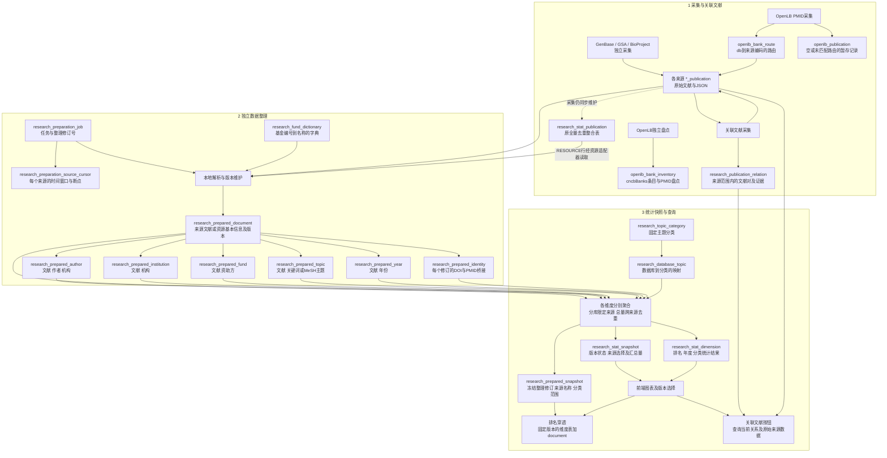
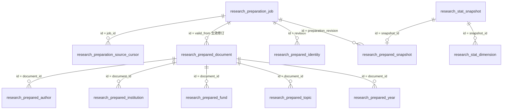

# 任务二数据库表关系与功能

本图按当前代码整理。箭头多数是应用层逻辑关联，并非数据库外键；本次没有添加外键、变更统计口径或执行历史回填。

## 业务路径

`openlb_publication`及盘点表不是新统计的数据源。`research_stat_publication`目前仍被采集同步；普通文献从各来源表整理，RESOURCE行仍由资源适配器从该表读取。新快照直接读取整理表，不在快照阶段从旧表展开维度，因此旧表目前不能删除。旧的`research_stat_dimension_candidate`和`research_stat_dimension_publication`不参与这条新统计路径。

## 新增表的逻辑关系

- 文献版本在`valid_from <= 快照修订`，且`valid_until`为空或大于快照修订时有效。
- `research_prepared_identity`在查询时按`快照修订 + DOI`与document逻辑关联，不通过document_id关联。
- `research_prepared_document.source_code`和维度表的`source_code`是来源编码，不是另一张全量表的ID。
- 不同数据库可以保存相同PMID；总统计按规范化文献键去重。来源内统计只读取该来源。
- 总统计的固定主题分类读取数据库映射；分库研究主题读取整理后的关键词/MeSH成员，两者口径不同。

## 关键字段与唯一性

| 字段 | 用途 | 不应混淆为 |
| --- | --- | --- |
| document.id | 某来源某条记录的整理版本ID | 全局文献唯一ID |
| document.source_row_id | 原始来源适配器的扫描行ID，可包含类型编码 | 一定等于原始表物理主键 |
| source_code + source_hash | 来源内业务记录身份；source_hash为source_key摘要 | 跨数据库去重键 |
| document_key | PMID、DOI或来源业务键形成的去重候选键；查询时还使用identity桥接 | 所有场景直接按此字段就能去重 |
| document_id | 维度成员所属的document版本ID | 作者ID或排名ID |
| member_key | 当前维度规范化值的摘要；作者维度为作者姓名加机构 | 可靠的自然人唯一身份 |
| author_order | 作者解析后的署名次序，从1开始；多机构展开保持同序号 | 作者统计排名 |
| revision / valid_from / valid_until | 整理版本、记录生效和失效边界 | 发表年份或时间戳 |

维度表唯一键是`(document_id, member_key)`。同一来源同篇文献中的同机构、同资助方、同主题只计一次；作者维度保留每位作者对应的机构，不能用第一位作者的机构代表整篇文献。

五张维度表复用了相同的成员结构，因此机构/基金/主题表中的`author_name`、`institution_name`、`author_order`目前为空；机构名称本身存`display_name`。`stat_year`目前只在年份表赋值。这些保留字段并非再次解析得到的数据。

## 两种穿透

1. 点击排名：使用快照冻结的修订和范围，经维度表`document_id`关联document，按文献标识去重，返回标题、来源及跳转地址。不会查询旧的维度-文献穿透关系表。
2. 点击文献的“关联文献”：以数据库编码及PMID/DOI/来源业务键查询`research_publication_relation`，再读取该来源原始文献表的详情。这条路径读取当前数据，并未冻结到快照修订。

## 字段注释SQL

- 新建库：`database/task2-preparation-20261126.sql`，10张表、113个字段均带中文注释。
- 已有库：`database/task2-preparation-comments-20261126.sql`，只修改已有字段/表注释，不回填数据；可重复执行。必须先具备现有整理表及增量字段。
- 原增量结构升级：`database/task2-preparation-incremental-20261126.sql`也已补注释；已有字段不要重复执行ADD COLUMN。

注释脚本带5秒元数据锁等待超时，并要求`ALGORITHM=INPLACE, LOCK=NONE`，不自动退化为复制表。建议整理和快照任务停止后执行；锁超时可以稍后重新执行。脚本不会启动采集、整理或快照任务。
