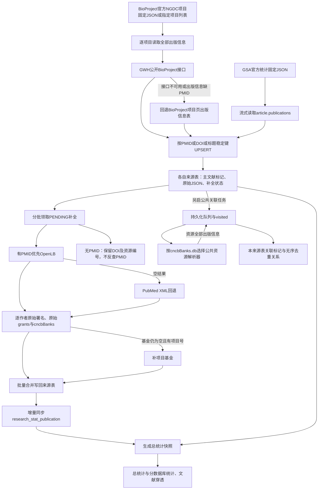

# GSA与BioProject采集、关联及统计流程（2026-11-24）

## 本次交付范围

GSA与BioProject独立主采集、批次写入、持久化游标、停止恢复、元数据补全、全局整合、公共关联采集、统计来源适配器、前端采集面板，以及独立API测试集合。

没有执行批量采集、历史回填或真实数据库DDL。SQL需要部署时执行。有限上游样本只用于确认字段与页面结构。

## 运行顺序

1. 先执行 `database/task2-gsa-collection-20261124.sql` 和 `database/task2-bioproject-collection-20261124.sql`，再启动新版后端。
2. 导入 `docs/apipost/task2-gsa-bioproject-20261124.json` 做本次新增功能测试；完整任务二接口使用 `docs/apipost/task2-all-interfaces-20261124.json`。
3. GSA调用 `POST /api/collection/gsa/jobs/start`；BioProject调用 `POST /api/collection/bioproject/jobs/start`。各自轮询 `/status`。
4. 主采集完成后按需要调用公共 `POST /api/collection/publication-relations/jobs/start-pending-batch`，databaseCode分别为GSA、BIOPROJECT。关联作业共用一个执行器，依次执行两个来源。
5. 确认任务完成后调用现有快照build接口，并查询快照status。进入总统计、主题数据库总览、分库统计、维度文献穿透、关联文献与外部论文链接。

独立主采集不会自动运行公共关联任务。这样可以先完成主数据，再按需控制递归关联的工作量；达到maxPublications后公共任务PAUSED，使用返回jobId恢复。

## 总流程



## GSA口径

采集官方支持文章统计的全部文章，包括页面HRA、OMIX等条目，用户明确要求统一归入GSA。官方统计JSON是静态全量响应，浏览器分页不等于服务端分页；下载时流式写磁盘，导入时Jackson流式读，不把整个JSON装入内存。

GSA主流程和字段详解见 `TASK2_GSA_COLLECTION.md`。

## BioProject口径与回退

官方浏览页NGDC标签读取 `https://ngdc.cncb.ac.cn/bioproject/json/ngdcBrowse.json`，根节点是项目数组。本实现采集该列表，不把INSDC标签混入。检查时该文件HTTP Last-Modified较旧，不能保证包含所有新项目，因此也提供指定项目编号模式；更新官方列表后再次成功扫描即可发现新项目。

每项目先读取 `https://ngdc.cncb.ac.cn/gwh/api/public/bioProject/{accession}` 的listPublication/listGrants/submitter.organization。出版信息缺PMID、列表空或接口不可用时，回退 `https://ngdc.cncb.ac.cn/bioproject/browse/{accession}` 的出版信息表。只解析对应表，不把页面下面的其他资源链接当成文章。

项目中所有出版论文均导入；没有论文的项目只推进项目游标，不创建假论文。多论文逐一处理，不以“只剩一篇”作为递归终止条件。真正关联发现由公共队列的访问去重、停止和上限控制。

项目提交单位保存在 `bioproject_raw_payload` 的projectOrganization中；这不是逐作者署名，不能直接分配给所有作者。每位作者自己的affiliation保存于authors_json，机构归一化仍在快照阶段执行。BioProject页面若只有作者字符串，原样保留于原始出版信息，不凭空拆出作者机构。

### 指定项目请求体

POST `/api/collection/bioproject/jobs/start`：

```json
{"batchSize":20,"minDelayMs":800,"maxAttempts":3,"projectAccessions":["PRJCA039050"]}
```

projectAccessions不传或空数组时扫描官方NGDC列表，最多指定1000个项目；编号校验支持PRJCA/PRJNA/PRJEB/PRJDA。首次DOWNLOAD阶段将选定范围固化到磁盘文件，失败/停止恢复必须继续原范围；改范围请调用jobs/restart。恢复时不会用新项目列表套旧游标。

## 接口：两套独立入口、同一组后缀

| 方法 | 后缀 | 功能 |
| --- | --- | --- |
| POST | /jobs/start | 首次启动；STOPPED/FAILED续做；SUCCESS后新建扫描 |
| POST | /jobs/restart | 放弃旧游标、新建扫描；保留论文与既有关系 |
| POST | /jobs/stop | 安全停止；等待当前请求/批次收尾 |
| GET | /status | 当前阶段、持久化游标、当前文献、计数、最近错误 |
| POST | /enrichment/reset | 保留数据，仅重置本库主文献补全状态 |

前缀分别为 `/api/collection/gsa` 和 `/api/collection/bioproject`。

GSA请求体batchSize/minDelayMs/maxAttempts；BioProject额外支持projectAccessions。批次1..200，间隔350..10000ms，重试1..5次。未提供分别默认100、800、3。

## 表与字段

复用gsa_publication和bioproject_publication，各自新增一个collection_job断点表，不新增论文暂存表。具体字段均在SQL内有COMMENT。

| 字段 | 含义 |
| --- | --- |
| gsa_record_key / bioproject_record_key | 来源表稳定唯一键：PMID、DOI或标题SHA256；补出PMID后保留旧键支持穿透 |
| gsa_raw_payload / bioproject_raw_payload | 官方原始出版信息；BioProject同时保留本项目基金和提交单位原文 |
| raw_payload | 最近获得的论文详情原文，不替代原始来源载荷 |
| gsa_source_hash / bioproject_source_hash | 原始来源信息变化判断；BioProject包含合并后的项目链接及基金 |
| source_hash | 补全后论文内容变化判断，用于关联状态重置 |
| bioproject_accession | 原始明确项目编号；不是作者机构 |
| gsa_accessions | GSA列表CRA/HRA/OMIX等原始资源编号 |
| *_enrichment_status | PENDING/SUCCESS/NO_PMID/EMPTY/FAILED |
| *_enrichment_error / attempts / checked_at | 失败原因、提交尝试计数及最后补全时间 |
| is_primary / is_related | 主文献与关联发现独立标记；同一篇可同时为真 |
| relation_status | 公共关联队列领取PENDING/FAILED，不由主采集自动启动 |
| job.next_index | GSA为文章游标，BioProject为已完整提交项目游标 |
| job.rows_imported | 接受的原始论文条数，包括重复更新，不等于新插入数 |

原有grants_json整体保存基金原始对象；OpenLB grants缺失时采用funding编号后备。项目grants与论文grants合并、已有非空信息保留；grantID和grantId按同一编号去重。快照只按agency统计，agency为空才用编号查询本地基金字典，未命中舍弃。acronym不再作为独立基金排名。

## 关联与无PMID论文

GSA与BioProject公共关联支持PMID、DOI、SOURCE_KEY；无PMID的项目出版信息也可存入本库并参与关联穿透。有PMID时公共流程优先OpenLB，空结果回退PubMed。已存在论文补is_related，不改变原is_primary。新发现的纯关联文献is_primary=0，默认不参与统计；includeRelated=true时才纳入。

队列唯一键防止重复处理，关系端点排序后写唯一键，A-B与B-A视为同一库内同一关系。公共队列资源解析器可扩展；其他尚未适配稳定来源键的旧来源继续使用原有PMID流程，不自动假定能存无PMID文章。

关联查询增加查询参数形式：GET `/api/collection/publication-relations/publications?databaseCode=BIOPROJECT&identifierType=DOI&identifier=10.1234%2Fabc&page=1&size=20`，避免DOI斜杠被路径路由拦截。原路径形式保留。

主采集/公共关联刷新时合并原机构作者、基金和资源链接，避免OpenLB返回空cncbBanks时覆盖本地已有项目链接。分库快照穿透读取自己的来源表稳定键；整合表仍按全局PMID/DOI等去重。只有标题兜底时无法保证同名不同论文不碰撞，这是待人工校验范围。

## 扩展代码位置

```text
controller/
  GsaCollectionController / BioProjectCollectionController  独立采集入口
service/impl/
  GsaCollectionServiceImpl / BioProjectCollectionServiceImpl  作业与断点
  GsaStatisticsReader / BioProjectStatisticsReader            流式列表读取
  GsaPublicationParser / BioProjectPublicationParser           来源字段映射
  BioProjectDocumentParser                                    项目API与页面回退
  GsaMetadataClient / BioProjectCollectionMetadataClient         各库调用门面
  PublicationMetadataEnricher / PubMedXmlMetadataParser          共用论文元数据
  NativeRelatedPublicationWriter                               无PMID来源表写入
  PublicationRelationCollectionServiceImpl                     共用关联队列
  *RelatedResourceResolver                                    按资源类型扩展
  GsaResearchPublicationSource / BioProjectResearchPublicationSource 统计适配
mapper/ + resources/mapper/                                   持久化SQL
portal-frontend/src/components/
  GsaCollectionPanel.vue / BioProjectCollectionPanel.vue        启停、恢复、进度
```

## 验证边界

本地测试覆盖列表流式断点、空项目、多论文、API→页面回退、基金/作者字段保留、实际Mapper的UPSERT与稳定键穿透，以及公共关联的原表读取。H2内存数据库使用MySQL模式，仅将MySQL空安全比较转换为等价标准语法，不修改真实库。

未运行全量上游采集和真实MySQL迁移，部署后先以单个项目或小批数据验证，再按需放开全量。需要生成新快照后查看新增来源的统计，旧快照不会自动补算。

## 本次执行结果

- 后端完整Maven测试：33项通过，0失败、0错误，BUILD SUCCESS（2026-11-24 16:18）。包括Spring应用启动、既有任务一目录接口、基金解析、GSA/BioProject采集解析与持久化、公共关联穿透。
- 前端npm run build通过；保留既有大包体积提示。
- 完整接口JSON：50个请求，自动核对50个Controller端点；新增GSA/BioProject及共用关联集合17个请求。
- 未执行真实MySQL迁移、批量爬取或历史回填；上游完整性与真实数据库性能需在部署后按需验收。

## 资源编号跳转补充（2026-11-24）

统计穿透和关联文献接口增加gsaAccessions、bioprojectAccession、cncbBanksJson；sourceUrl优先PMID→DOI，其后使用本篇文章明确关联的GSA/BioProject编号。GSA统一跳转https://ngdc.cncb.ac.cn/gsa/browse/{CRA编号}，BioProject跳转https://ngdc.cncb.ac.cn/bioproject/browse/{项目编号}。

前端保留论文入口，同时显示可用的资源编号链接。没有PMID/DOI时明确显示“查看GSA数据”或“查看BioProject项目”，这些是资源详情页，不冒充论文全文。存在多个资源编号时全部展示，按编号去重。绝不使用evidenceUrl作为关联另一篇论文的地址。

已有文献只要保存了对应编号或cncbBanks即可通过现有查询得到链接；不需要重建快照、历史回填或修改数据库结构。接口地址不变。复查后端37项测试、前端3项链接测试及前端构建均通过。

最新约束：不反查、不补写来源缺失的PMID。源数据原来提供的PMID照常保存；源数据后续更新原生标识时才随来源更新。资源和文献的统计模式以最新约定为准，不能把无文献资源伪造成文章。
