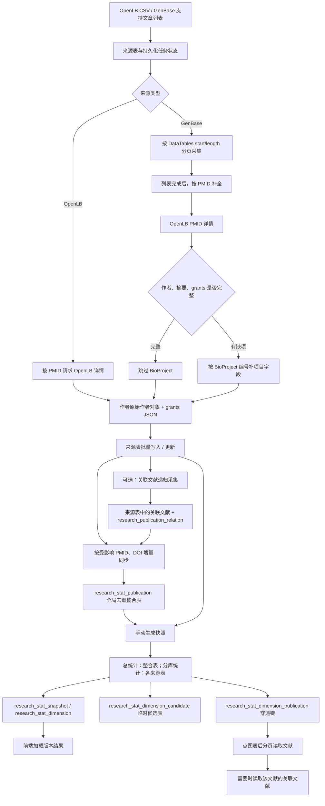
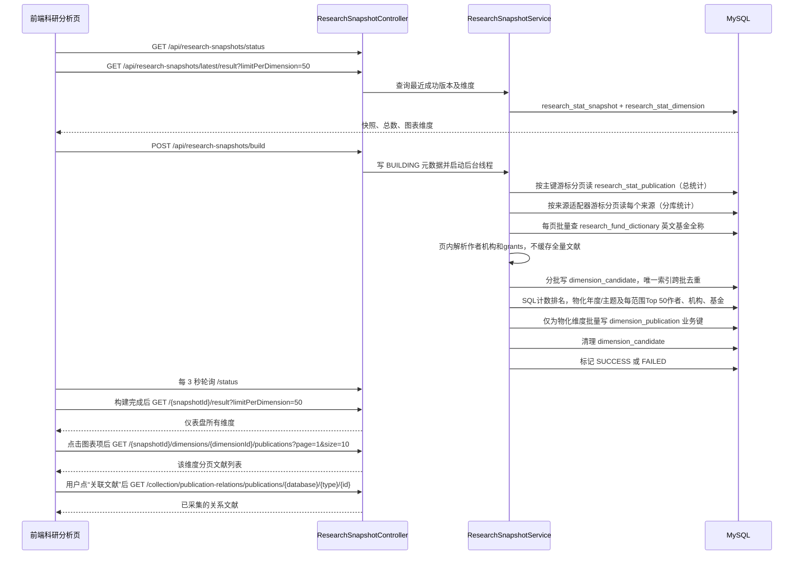

# 任务二：文献采集、整合、快照与前端展示

本文描述当前代码的实际边界。外部数据采集由接口显式触发；页面加载和快照生成都不会访问 OpenLB、GenBase、BioProject 或 ROR。

## 总流程

## 三种采集与整合入口

| 用途 | 接口 | 会做什么 | 不会做什么 |
|---|---|---|---|
| OpenLB PMID 主采集 | `POST /api/collection/openlb/tasks/import-csv`，随后 `POST /api/collection/openlb/jobs/start` | CSV PMID 入 `openlb_pmid_task`；后台逐个请求 OpenLB，限速、重试、断点；成功详情批量写 `openlb_publication`，并增量同步总表 | 不自动导入 GenBase；不自动启动关联递归 |
| GenBase 主采集 | `POST /api/collection/genbase/jobs/start` | 分页采集 `getSupportPaperList` 到 `genbase_publication`；列表完成后自动按状态读取 PMID、请求 OpenLB 补作者/机构/基金；必要时才查 BioProject | 不会重置或重新导入 OpenLB CSV 队列 |
| GenBase PMID 补全重跑 | 先 `POST /api/collection/genbase/enrichment/reset`，再调用上面的 start | 保留文献，只重置 GenBase 行的 OpenLB 补全状态；再次补全后更新来源表和总表 | 不删除文献，也不访问 OpenLB 主任务表 |
| 关联文献递归 | `POST /api/collection/publication-relations/jobs/start-pending-batch` | 按来源表的待关联记录建队列；沿 CNCB 资源链接发现文献，保存双向去重关系；新增/更新来源文献后增量同步总表 | 不会由快照生成自动触发 |
| 整合表全量重建 | `POST /api/research-publications/integration/rebuild` | 从所有已注册来源重读，按 PMID/DOI/来源键全量重建全局去重表 | 不采集外部网站，不建立快照 |
| 快照生成 | `POST /api/research-snapshots/build` | 读取总表和每个已注册来源表，生成维度和穿透关系 | 不重采集来源数据，不更新/合并 `research_stat_publication` |

OpenLB 采集状态：`GET /api/collection/openlb/status`。GenBase 状态：`GET /api/collection/genbase/status`。关联任务状态：`GET /api/collection/publication-relations/jobs/status`。总表重建状态：`GET /api/research-publications/integration/status`。快照构建状态：`GET /api/research-snapshots/status`。

## 主要表和字段

### 来源记录表

| 表 | 字段组 | 含义 |
|---|---|---|
| `openlb_pmid_task` | `pmid`、`status`、`attempt_count`、`last_error`、`next_retry_time` | OpenLB CSV 的持久化请求队列。状态为 `PENDING/RUNNING/SUCCESS/EMPTY/FAILED`；已成功或确定无记录的项不会重复请求，失败可重试。 |
| `openlb_publication` | `pmid`、`doi`、`title`、`pub_year`、`journal_title` | OpenLB 来源文献业务字段；PMID 唯一。 |
| 〃 | `authors_json`、`affiliation_info` | 采集阶段保留逐作者原始署名和文章机构文本，不在网络采集期间逐作者请求ROR；快照阶段解析作者机构并按“姓名+机构”聚合。 |
| 〃 | `keyword_list`、`mesh_headings_json` | 原始关键词和 PubMed MeSH，用于分数据库主题统计及后续检索。 |
| 〃 | `grants_json` | 原样保存上游 `grants` 对象数组；若 `grants` 缺失/为空则把 `funding` 编号标准化为 `[{"grantId":"..."}]`。不在采集阶段解析基金。 |
| 〃 | `cncb_banks_json` | OpenLB 返回的 CNCB 数据库/资源关联，用于主题标签和关联发现。 |
| 〃 | `raw_payload` | 原始 API 响应证据；解析规则修正时可离线重解析，不必再次请求上游。 |
| `genbase_publication` | `paper_id`、`pmid`、`doi`、`bioproject_accession`、`genbase_accessions` | GenBase 文献列表记录及其业务标识。`paper_id` 是 GenBase 列表行标识；PMID/DOI 用于跨来源整合。 |
| 〃 | `openlb_status`、`openlb_attempt_count`、`openlb_last_error`、`openlb_last_attempt_time`、`openlb_completed_time` | GenBase 行的 PMID 详情补全进度，不是 OpenLB 主采集状态。 |
| 〃 | `abstract_text`、`authors_json`、`affiliation_info`、`keyword_list`、`mesh_headings_json` | OpenLB/必要时 BioProject 补全的论文字段。 |
| 〃 | `grants_json`、`openlb_raw_payload` | 保存合并后的原始基金对象；`openlb_raw_payload` 保留 OpenLB 原始详情以便离线重解析。 |
| 〃 | `is_primary`、`is_related`、`relation_status`、`relation_attempt_count`、`relation_last_error` | 这篇记录是否由 GenBase 原始列表提供、是否也被关联发现、以及是否已完成递归发现。主记录可以同时被关联发现。 |
| `genbase_collection_job` | `next_start`、`page_size`、`records_total`、`rows_seen`、`rows_inserted`、`attempt_count`、`status` | GenBase 分页扫描断点、统计进度和错误信息；停止/重启后按 `next_start` 续跑。 |

### 关联表、全局整合表与快照表

| 表 | 含义 |
|---|---|
| `research_publication_relation` | 来源范围内的文献双向关系。以 `database_code + 两端业务唯一值 + relation_type` 唯一；两端按稳定顺序存储，避免 A→B 与 B→A 重复。 |
| `research_relation_crawl_job`、`research_relation_crawl_queue` | 递归关联任务和可断点队列，保存根唯一值、请求参数、深度、状态、错误和计数。 |
| `research_stat_publication` | 一篇文献全局只存一行。`publication_key` 按 PMID、DOI、来源业务键取唯一值；`source_codes/source_record_keys` 表示各来源中的业务键；`content_hash` 判断变化；作者、机构原文、原始 `grants_json`、关键词和 CNCB 关联是统计使用的合并字段。 |
| `research_stat_snapshot` | 一次统计版本的元数据：名称、版本、来源、是否包含纯关联文献、统计总量、字段覆盖数、构建状态和时间。 |
| `research_stat_dimension` | 快照中的统计结果。`scope_code=TOTAL` 是总统计；其他值是来源代码。`dimension_type` 当前为 YEAR/TOPIC/AUTHOR/INSTITUTION/FUND/DATABASE；`dimension_key` 是维度业务键；`display_name` 是界面名称；作者维度另存 `author_name` 和 `institution_name`。 |
| `research_stat_dimension_publication` | 精简穿透关系：每个“快照维度”关联该计数下的文献业务唯一值。总统计使用全局 PMID/DOI 文献键；分数据库使用来源表的稳定键，因此分库数与分库穿透一致。没有另建每篇文献一行的快照副本表。 |
| `research_stat_dimension_candidate` | 快照构建期间使用的临时候选表。每行代表一条“统计维度—文献唯一值”；复合主键跨批去重。数据库端从中计数排名、只保留每范围Top 50作者/机构/基金，再生成正式穿透关系；成功、失败、停止及应用重启恢复后都会清理候选行。基金名称在批次处理时查字典，不把所有文献载入内存。 |

## 采集处理细节

1. **OpenLB PMID**：CSV → `openlb_pmid_task` → OpenLB API → 原始记录解析 → 作者署名保留、基金统一成原始 grants JSON → `openlb_publication` 批量写入 → 只同步受影响 PMID 到整合表。
2. **GenBase**：DataTables 分页 → `genbase_publication` 批量插入/更新 → 列表完成后按 `openlb_status` 领取有 PMID 的行 → OpenLB PMID API。OpenLB 的作者、摘要及基金字段完整时跳过 BioProject；基金字段优先 grants，缺失时可用 funding；缺少主要元数据才请求 BioProject。成功后批量回写补全字段，并同步受影响 paper_id/PMID。
3. **作者机构**：采集时不调用ROR、不预先拆分机构；`authors_json` 保留每个作者对象和原始 affiliation。快照逐作者读取 affiliation 并提取机构；显示姓名按 `firstName/foreName/givenName + lastName/familyName` 组合，作者和机构始终来自同一个对象。作者未提供机构时才借用同篇文章内其他作者的机构。
4. **基金**：采集优先保留上游 `grants[]` 全部对象；为空时再读取 `funding` 并写成统一的 `grantId` JSON。OpenLB 口径为 `agency` 是资助机构，`acronym` 是缩写。快照每页批量查询 `research_fund_dictionary`，先用 `grantId` 找英文全称；没有字典命中则回退 `acronym`、项目名，最后才用编号。快照不请求外部基金服务。
5. **批处理**：目录分页一次请求一页并批量写表；OpenLB 补全有并发上限、请求间隔、限速退避和任务状态；关系队列可续跑。GenBase 总耗时主要发生在列表之后的逐 PMID OpenLB 补全阶段，而不是 DataTables 一页页读取阶段。当前 OpenLB 详情接口按 PMID 查询，没有单次批量详情请求；并发受全局节流间隔约束，以避免上游限流。

## 快照生成和读取

- 快照生成读取本地两类数据，但只写 `research_stat_snapshot`、`research_stat_dimension` 和 `research_stat_dimension_publication`；不会整合或去重来源文献。总表增量同步发生在来源行新增/变化时。只有手动点击“全量重建整合表”才全量重读来源表。
- 总统计按全局唯一文献键去重；分库统计按各自来源表业务键统计。`includeRelated=false` 时纯关联发现文献排除；主文献同时被关联发现仍计入。该开关保存在快照里。
- 年度维度保留所有年份；TOPIC/AUTHOR/INSTITUTION/FUND 每个统计范围最多存前 50 项；DATABASE 统计项保留。点击页面 Top 10/20/…/50 在已存的前 50 项中切片，不会重新统计。
- 总统计主题来自 `cncb_banks_json` 与已确认的 `research_database_topic → research_topic_category` 映射；分数据库主题使用该来源对应的已确认类别映射。一个文献可以计入多个类别。
- 年度与主题维度先根据实际年份和已确认分类预建少量维度；分页扫描时，文献业务唯一键直接批量写入正式穿透关系并从关系表汇总计数，不经过 `research_stat_dimension_candidate`。候选表仅暂存作者、机构、基金，用于跨批次去重计数和Top 50筛选。
- AUTHOR 维度键为规范化作者名 + 机构。同名但机构不同会分开；页面穿透到该维度对应的业务文献键，而不是遍历所有文章。
- 页面首次加载最近成功快照；版本下拉框选择旧快照后请求该版本结果。年度起止筛选、Top 数切换在前端完成。新快照按钮先查构建状态；运行时禁用按钮。重命名和删除只作用于快照及其维度/穿透行，不删除全局文献。
- 总统计和分数据库统计使用两个结果接口。分数据库页读取 `/databases` 再请求 `/databases/{databaseCode}/result`；图表穿透仍使用所选 `dimensionId` 分页读取。

## 当前需记住的边界

- 来源注册中心通过 Spring 自动发现适配器；快照构建器只遍历已启用来源，不包含 `OPENLB`/`GENBASE` 分支。新增统计来源需提供来源代码、名称、按ID游标分页读取及按来源业务键批量回查的适配器和对应Mapper SQL；停用来源可通过适配器 `enabled()` 控制，不需改快照汇总器。表结构不同的采集器仍需各自实现适配器，不能仅靠配置自动猜测字段。
- 旧 `fund_level1_json` / `fund_level2_json` 已由 `V25__store_raw_grants_and_dictionary.sql` 迁移为单个 `grants_json`；旧快照仍是历史值，重新生成快照才按新规则统计。基金全称字典通过 `research_fund_dictionary` 批量导入维护。
- `V25` 是手动数据库迁移文件，不会在应用启动时自动执行。先备份三张文献表，再对当前数据库执行 V25；它从来源 raw payload 回填 `grants_json`，创建字典表，并删除两个旧的解析基金字段。执行完成后，再运行整合表全量重建，然后生成新快照。旧 raw payload 会保留。
- 不在本文档或本次代码工作中触发任何上游批量采集。需要采集时由操作者调用相应入口，并通过状态接口观察进度。

## 基金统计口径更新（2026-11-24）

总统计与分数据库统计共用同一解析规则：
1. 优先使用每个grants_json对象的agency（排除null、空字符串、纯空白、字符串null）。
2. agency缺失时，依次读取grantId、grantID、grantNumber、id中有效编号，按本页去重编号批量查询research_fund_dictionary。
3. 只使用ENABLED字典记录的有效full_name；未匹配或名称为空就舍弃，不展示编号。
4. acronym、program、grantTitle和legacyFundLevel1/2不再额外生成统计项，不再添加“资助方 · /项目 ·”前缀。
5. 同一文献同名基金只计一次；Top50、文献穿透仍使用原有公共流程。

采集端仍保存完整grants_json，不需修改表、不需重新采集。重启服务后生成新快照才应用新口径，既有快照保持历史结果。前端基金表格共用于总统计及分库统计。

## GSA独立主采集（2026-11-24新增）

先执行database/task2-gsa-collection-20261124.sql，再调用POST /api/collection/gsa/jobs/start。
该入口读取官方支持文章完整静态JSON，按用户选择包含全部HRA/OMIX等条目统一归入GSA，固定快照流式分批导入及元数据补全，变化批次增量同步总库。
状态、停止、断点、新扫描及重置补全由GSA专用Controller管理；关联采集仍使用公共publication-relations接口并传databaseCode=GSA。
详见同目录TASK2_GSA_COLLECTION.md；新增测试集合docs/apipost/task2-gsa-collection-20261124.json。

2026-11-24补充BioProject独立主采集、指定项目范围、全部出版信息导入、PMID优先与页面回退、无PMID稳定键关联。GSA与BioProject完整流程、字段和部署顺序详见同目录TASK2_GSA_BIOPROJECT_WORKFLOW.md。
